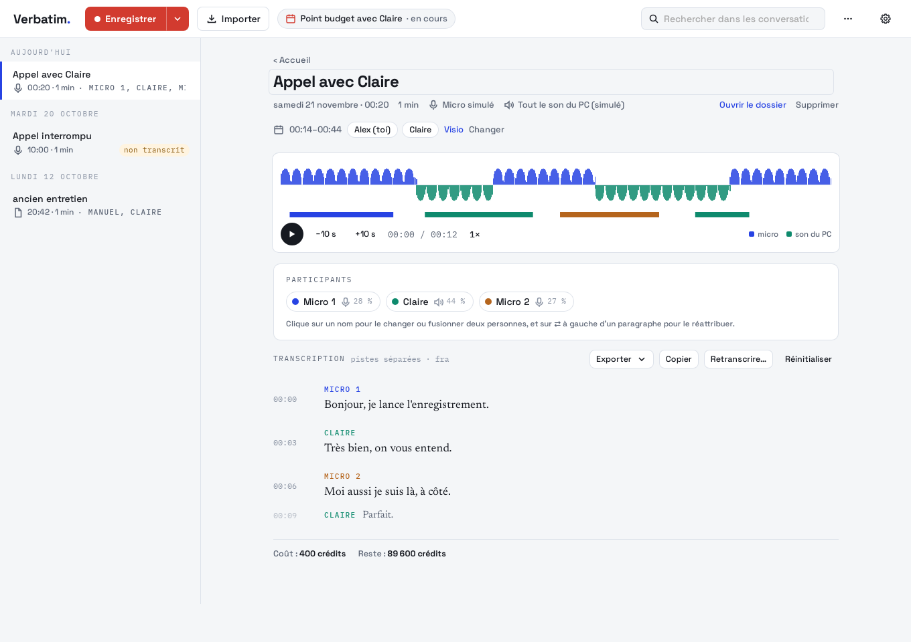

# Verbatim

Enregistre et transcrit tes conversations sur Windows : ton micro, le son du
PC (visio, appel, vidéo), ou les deux à la fois. Importe aussi des fichiers
audio et vidéo. La transcription sépare les personnes et te laisse les nommer.

## Télécharger

**[Télécharger Verbatim.zip](https://github.com/Rnaock/verbatim/releases/latest/download/Verbatim.zip)**
(Windows 10 ou 11, 64 bits, environ 4 Mo)

## Installation

1. Clic droit sur `Verbatim.zip` → **Propriétés** → coche **Débloquer** → OK.
2. Extrais le dossier `Verbatim` où tu veux le garder. Laisse les fichiers
   ensemble : `Verbatim.exe` a besoin de `WebView2Loader.dll` à côté de lui.
3. Lance `Verbatim.exe`. Pour un raccourci : clic droit sur le fichier →
   **Afficher d’autres options** → **Envoyer vers** → **Bureau**.

Au premier lancement, Windows peut afficher « Windows a protégé votre
ordinateur », car le logiciel est distribué sans signature payante. Clique sur
**Informations complémentaires**, puis **Exécuter quand même**. Ça n’arrive
qu’une fois.

Verbatim pose ensuite quatre questions, toutes modifiables plus tard dans les
réglages : ton prénom, ta clé ElevenLabs, ton agenda, la langue de tes
conversations.

## Créer ta clé ElevenLabs

La transcription passe par [ElevenLabs](https://elevenlabs.io) (modèle
Scribe v2). Il te faut ton propre compte, avec des crédits.

1. Sur elevenlabs.io : **Developers** → **API Keys** → **Create Key**.
2. Nom : `Verbatim`. Active **Restrict Key**.
3. Autorise **Speech to Text**, mets **User** sur **Read** (pour que Verbatim
   affiche ton solde) et laisse le reste désactivé.
4. La clé ne s’affiche qu’une fois : copie-la et colle-la dans Verbatim.

Coût constaté : environ 0,20 à 0,25 € par heure d’audio en mode Automatique,
le double en pistes séparées. Verbatim affiche le coût de chaque
transcription et ton solde.

## Tes données

- Les enregistrements et les transcriptions restent sur ton PC
  (`Documents\Verbatim`).
- L’audio part uniquement chez ElevenLabs, au moment de transcrire.
- Ta clé et l’adresse de ton agenda sont chiffrées par Windows sur ton PC.
- Aucune télémétrie, aucun compte Verbatim.

## Mises à jour

Verbatim vérifie au lancement si une nouvelle version existe ici et te
l’annonce. Rien ne s’installe sans ton accord.

**Verbatim est un projet amateur.** Une mise à jour apporte des nouveautés et
des corrections, et peut aussi casser quelque chose qui marchait. Si ta
version te convient, tu peux la garder (bouton **Ignorer cette version**).

Pour revenir en arrière après une mise à jour :

- dans Verbatim : Réglages → **Version** → **Revenir à Verbatim x.y** ;
- si Verbatim ne démarre plus : dans son dossier, supprime `Verbatim.exe`
  puis renomme `Verbatim-precedent.exe` en `Verbatim.exe` ;
- toutes les versions restent téléchargeables dans les
  [Releases](https://github.com/Rnaock/verbatim/releases).

Tes conversations, ta clé et tes réglages restent en place.

## Si Verbatim plante

Au lancement suivant, Verbatim propose d’envoyer un rapport technique à
l’auteur par mail. Tu le relis avant, et rien ne part sans ton clic. Il ne
contient ni titre, ni nom, ni texte de conversation.

## Une idée, un bug

Dans Verbatim : menu **⋯** → signaler un bug ou proposer une idée. Tu peux
aussi ouvrir une [issue](https://github.com/Rnaock/verbatim/issues).

## Pour aller plus loin

- Guide complet : [LISEZMOI.md](LISEZMOI.md)
- Compiler et tester : [COMPILER.md](COMPILER.md) (Rust, Tauri 2)
